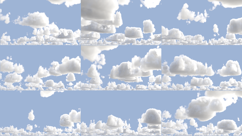

# EzCloudGen artist guide

A practical guide for compositors and lighters: getting clouds into a shot, the knobs that matter,
and recipes for common looks. The README covers every knob in detail; this guide is the short path.

## Five-minute start

1. **Paste the node.** `groups/EzCloudGen_group.nk` into your script, or create *EzCloudGen* with
   `gizmos/` on the plugin path.
2. **Plug in the plate and camera.** **bg**: your plate (it sets the format). **camera**: the
   shot camera (a tracked camera works as is).
3. **Set the units.** On the EzCloudGen tab, **units to metres** is how many metres one scene unit
   is: 0.1 for decimetre scenes, 1 for metres, 0.01 for centimetres. Heights and distances in the
   panel are always in metres.
4. **Point the sun.** On the Light tab: plug an **Axis** into **sun**, or an **EzAtmosScatter**
   into **atmos** (it gives the sun direction and the sun and sky colour from its HDRI), or type
   a **sun direction**.
5. **Pick a type.** On the Layer 1 tab, choose a **type**. Decks (Cumulus, Stratocumulus...) fill
   the sky; volumes (Hero Cumulus, Storm Anvil...) are single clouds placed ahead of the camera.
6. **Look.** The default **render preset** is *shot*. Switch to *draft* while you work.

If the plate has a **depth** channel, the clouds go behind its mountains and buildings ('hide
behind bg'): set **depth is** to match your renderer (Planar Z for Arnold, Karma and V-Ray; 1/Z
for ScanlineRender; Distance for a distance pass).

## The panel

| Tab | What lives there |
|---|---|
| **EzCloudGen** | the view, render preset and quality, scene units, bg depth, ground shadows |
| **Light** | sun and sky, light diffusion, wrap light, sun glow, and the look features (detail sharpness, billow light, light grid...) |
| **Air, time & map** | haze, the gap toward the sun, evolve (time), variations, the coverage map |
| **Layer 1, 2, 3** | each layer's type, shape, erosion and detail; the **more shape** sub-tab has the finer controls |

Three layers render together: they interleave where they overlap and shadow each other.

## Render settings

**render preset** sets four knobs at once:

| preset | use it for | time (2400x1760 clouds, RTX GPU) |
|---|---|---|
| draft | look-dev; grainy edges | about 2.5 s |
| shot | most shots | about 9 s |
| hero | close-ups, stills | about 12 s |

**sampling** (Low, Medium, High, Ultra) works the samples per pixel out from the plate's width, so
you don't have to guess. If Ultra still isn't clean enough, **Manual** lets you set **samples**
yourself. The **preview** checkbox is a quicker draft still (half resolution, one sample, only the
passes the view needs).

What costs time: samples, and **edge steps** (1 is about a third faster but grainy). The look
features cost little.

**Render on GPU machines.** On the CPU a frame takes minutes, not seconds, and each machine's first
render compiles the kernels (about an hour, once per machine; see README, "Render farm and CPU").

## Choosing a cloud type

| You want | Type | Notes |
|---|---|---|
| Fair-weather sky | **Cumulus** | flat bases, cauliflower tops |
| Big towering cumulus field | **Cumulus Congestus** | tall; lower coverage for a few big towers |
| One hero cloud | **Hero Cumulus**, **Soft Cumulus**, **Towering Cumulus** | placed volumes; move, size, or plug a box |
| Storm | **Storm Anvil**, **Shelf Cloud** | |
| Low grey deck | **Stratocumulus**, **Stratus** | |
| Mackerel sky | **Altocumulus**, **Cirrocumulus** | |
| Overcast | **Altostratus** | |
| High wisps | **Cirrus** | |
| Fog drifting through a valley | **Fog Bank**, **Ground Fog**, **Wispy Fog**, **Torn Low Cloud** | volumes; layer two or three for parallax |
| Flying into valley fog | **Valley Fog** | set 'base' just above the valley floor |
| Mist lying on a forest | **Canopy Mist** | set 'base' to the treetops; 'wind speed' drifts it |

Each type also sets its **detail model**: *soft billows* (soft, see-through puffs and wisps, for
cumulus and every volume) or *classic* (crisp cauliflower, for stratiform and mackerel decks).

## Finding a look you like

- **Variations.** On Air, time & map, set **variations of** to the layer and press **show me
  variations**: nine seeds side by side over a plain sky, numbered. Type the one you like into
  **use number** and press **use it**. **next nine** shows more.
- **Seed** (each layer) changes just that layer; **seed** (global) changes everything.
- **coverage** is how much of the sky is cloud; **density** thins or thickens the cloud without
  changing its shape; **size** sets how big the clouds are.

## Placing clouds where you want them

- **A volume:** pick a volume type and it lands **distance** ahead of the camera. Move it with
  **position**, or press **make 3D box** and move the wireframe cube in the 3D viewer. Any 3D node
  in **box1/2/3** works, including a tracked or parented one.
- **A deck:** paint a **coverage map** (a Roto over the plate is fine) into **map**: white piles
  clouds up, mid grey leaves the layer as it is, black clears it. It is seen through the camera on
  **map frame**, stays put in the world and drifts with the wind.
- **A painted silhouette:** set the layer's **map use** to *silhouette* and paint the cloud mass's
  outline as the camera sees it, with **silhouette distance** and **depth** for where it stands.

## Recipes

**Backlit cumulus (sun behind the clouds).** On Light: **light diffusion** 1, **wrap light** 1,
**sun glow** 0.5 to 1, **highlight rolloff** 0.15. Edges and thin cloud near the sun glow and the
light wraps round the outline. Set **billow shrink** to about 0.6 for big soft lobes low down and
tighter cauliflower up top. Leave colour and tone to your grade.

**Front-lit fair-weather cumulus.** The defaults: billow light 1 and detail sharpness 0.6 keep
shaded folds between the lobes, and light diffusion stays at 0.

**Valley fog fly-through (FPV).** Valley Fog type with **base** just above the valley floor; the
ridges stand out of it. Lower **density** (around 0.25 to 0.5) to see into it as the camera dives
through. Turn **light grid** off for fly-throughs (see Known issues). A synthetic example scene is
in `_scenes/valley_fog_fpv` (not part of the repo).

**Ground fog drifting past.** Ground Fog or Wispy Fog volumes at two or three distances, with
**fade bottom** so the fog sits flat on the ground and tears away above.

**A sky that moves.** Each layer's **wind speed** and **wind direction** drift it; **evolve** (Air,
time & map) changes the shapes slowly over time. Turn on **motion vectors** for VectorBlur.

## Comping the outputs

- **rgba**: the comp (or the clouds alone in the Clouds view).
- With **breakout layers**: *cloud* (rgba), *cloud_sun* and *cloud_sky* (rgb) to re-grade sun and
  sky light separately, *cloud_shadow* (the clouds' shadows on the bg, needs bg depth).
- **depth.Z**: Planar Z of the clouds, for EzDepthHaze and defocus.
- **forward / backward**: motion vectors, with **motion vectors** on.
- **sun shadow layer** (*cloud_sunmap*): feeds EzCloudShafts for sun rays through the clouds.
- Precomp the node with your own Write (channels: all) for fast playback and farm renders.

## Troubleshooting

| You see | Do this |
|---|---|
| Grainy or speckled edges | raise **sampling**, or **edge steps** to 3 |
| Far deck shimmers on camera moves | keep **horizon samples** at 4 (the default) |
| Clouds in front of the mountains | check bg depth: **depth**, **depth is**, **units to metres** (EzCloudGen tab) |
| Clouds blown out near the sun | **highlight rolloff** 0.15 to 0.3 |
| Render too slow | render preset *draft* or **preview** while you work |
| Flat stripes inside a volume you fly into, with a deck above | **light grid** off (known issue) |
| The node is "computing" forever on a CPU farm node | it is compiling (once per machine, about an hour); render on GPU |

## Known issues

- **Light grid stripes:** with the camera inside a placed volume under a deck, the light grid can
  draw flat stripes. Turn **light grid** off for those shots; it costs nothing in render time.
- **CPU rendering** is very slow (minutes a frame) and compiles for about an hour on each
  machine's first render. Use GPU nodes.
